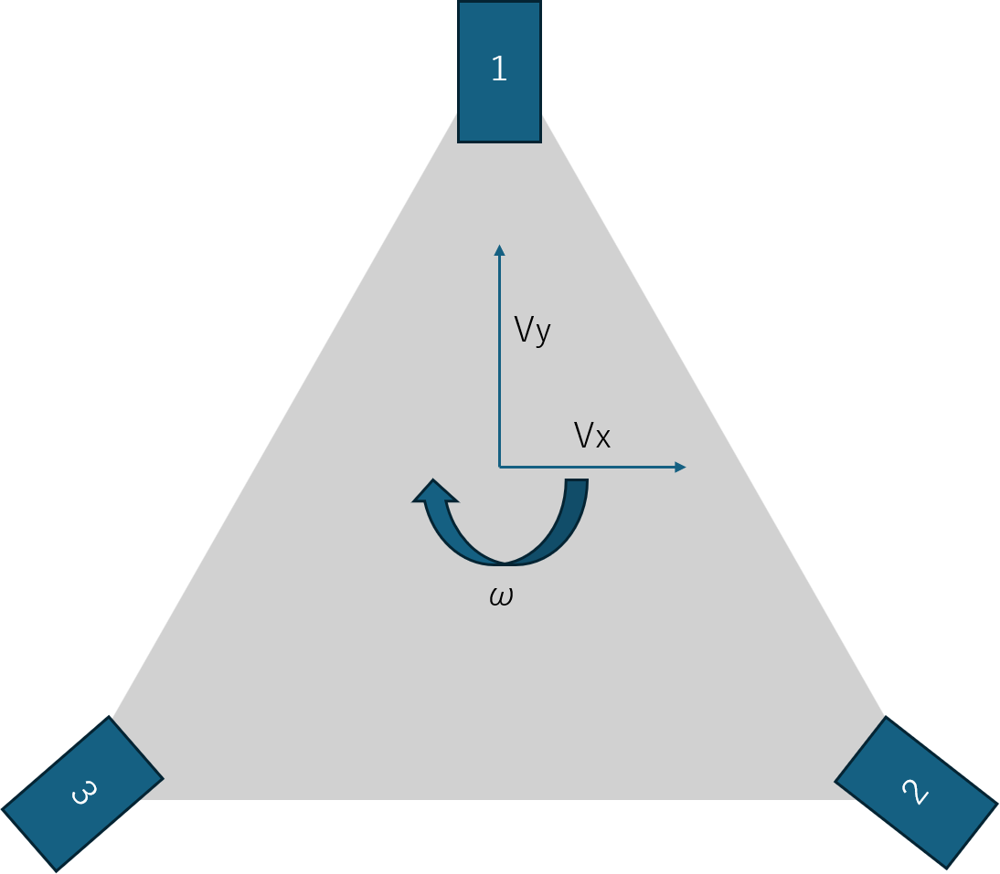

## 1. 座標系と条件

画像の配置を基に、タイヤ1を前方、タイヤ2を右後方、タイヤ3を左後方として定式化する。

入力値と座標系

右が +X、前が +Y、右回転が正

| 入力速度       | $ V_x,V_y $ [mm/s] |
| ---------- | -------------------- |
| 角速度        | $ \omega $ [deg/s] |
| 中心から各タイヤまで | $ R=190.53 $ mm    |
| タイヤ直径      | $ D=70 $ mm        |
| タイヤ半径      | $ r=35 $ mm        |

## 2. 各タイヤの位置

正三角形の頂点にタイヤが配置されているものとする。

タイヤ配置の模式図。以下の計算では提示画像の番号と座標を使用する。

| タイヤ   | $ x_i $ [mm] | $ y_i $ [mm] |
| ----- | -------------- | -------------- |
| 1：前方  | 0              | +190.53        |
| 2：右後方 | +165.00        | −95.265        |
| 3：左後方 | −165.00        | −95.265        |

ここで、

$$  165.00=\frac{\sqrt{3}}{2}R,\qquad 95.265=\frac{R}{2}  $$

である。

## 3. 逆運動学の基本式

ロボット中心の並進速度に、ロボットの回転による各タイヤ位置での速度を加算する。

角速度を計算用に rad/s へ変換する。

$$  \Omega=\omega\frac{\pi}{180}  $$

右回転を正とするため、位置 $ (x_i,y_i) $ にあるタイヤの速度成分は次式になる。

$$  \boxed{ \begin{aligned} v\_{x_i}&=V_x+\Omega y_i\\\ v\_{y_i}&=V_y-\Omega x_i \end{aligned} }  $$

- $ v\_{x_i} $：タイヤ位置における右向き速度成分 [mm/s]
- $ v\_{y_i} $：タイヤ位置における前向き速度成分 [mm/s]

この式により、並進と旋回が同時に発生する場合も計算できる。

## 4. 各タイヤの速度成分

### タイヤ1（前方）

$$  \boxed{ \begin{aligned} v\_{x_1}&=V_x+190.53\Omega\\\ v\_{y_1}&=V_y \end{aligned} }  $$

### タイヤ2（右後方）

$$  \boxed{ \begin{aligned} v\_{x_2}&=V_x-95.265\Omega\\\ v\_{y_2}&=V_y-165.00\Omega \end{aligned} }  $$

### タイヤ3（左後方）

$$  \boxed{ \begin{aligned} v\_{x_3}&=V_x-95.265\Omega\\\ v\_{y_3}&=V_y+165.00\Omega \end{aligned} }  $$

## 5. 各タイヤの駆動速度とステアリング角度

各タイヤについて、速度成分から速度の大きさとステアリング角度を求める。

### タイヤ速度

$$  \boxed{ v_i=\sqrt{v\_{x_i}^2+v\_{y_i}^2} }  $$

単位は mm/s である。これはタイヤの接地点に必要な並進速度の大きさである。

### ステアリング角度

前方（+Y）を $ 0^\circ $、右方向（+X）を $ +90^\circ $ と定義する。

$$  \boxed{ \theta_i=\operatorname{atan2} (v\_{x_i},v\_{y_i})\frac{180}{\pi} }  $$

この引数順序に注意する。通常の数学的な角度とは異なり、今回は前方の +Y 軸を基準にするため、`atan2(vx, vy)` とする。

各タイヤの式をまとめると以下のとおりである。

| タイヤ | 駆動速度 [mm/s]                                         | ステアリング角度                                                   |
| --- | --------------------------------------------------- | ---------------------------------------------------------- |
| 1   | $ \sqrt{(V_x+190.53\Omega)^2+V_y^2} $             | $ \operatorname{atan2}(V_x+190.53\Omega,V_y) $           |
| 2   | $ \sqrt{(V_x-95.265\Omega)^2+(V_y-165\Omega)^2} $ | $ \operatorname{atan2}(V_x-95.265\Omega,V_y-165\Omega) $ |
| 3   | $ \sqrt{(V_x-95.265\Omega)^2+(V_y+165\Omega)^2} $ | $ \operatorname{atan2}(V_x-95.265\Omega,V_y+165\Omega) $ |

表の角度は度に変換して使用する。

## 6. タイヤの回転数 [rpm] への変換

モーター制御にタイヤ回転数が必要な場合は、タイヤ直径 $ 70 $ mm を用いて変換できる。

タイヤの円周は、

$$  C=\pi D=70\pi\ \mathrm{mm}  $$

である。したがって、タイヤ回転数は、

$$  \boxed{ n_i=\frac{60v_i}{70\pi} }  $$

となる。$ v_i $ が mm/s、$ n_i $ が rpm である。ギヤ比を考慮したモーター回転数が必要な場合は、さらに減速比を乗じる。

## 7. 無限回転ステアリングの扱い

`atan2` の返却範囲は通常 $ -180^\circ $ から $ +180^\circ $ である。しかし、ステアリング機構自体の角度に制限がない場合は、制御側で前回角度に近い解を選択することが望ましい。

例えば、目標角度が $ +179^\circ $、現在角度が $ -179^\circ $ の場合、単純な差分ではなく、角度を連続化して $ 2^\circ $ の移動として扱う。

また、独立ステアリングでは次の等価解を利用できる。

$$  (v_i,\theta_i) \equiv (-v_i,\theta_i+180^\circ)  $$

すなわち、ステアリングを $ 180^\circ $ 反転し、駆動速度の符号を反転しても、タイヤが作る速度ベクトルは同じである。これを使えば、ステアリングの移動量を小さくできる。ただし、負の駆動速度をモーター制御側で扱えることが条件となる。

停止時の例外： $ v_i=0 $ の場合は速度ベクトルから角度を決定できないため、角度指令を前回値に保持する。
