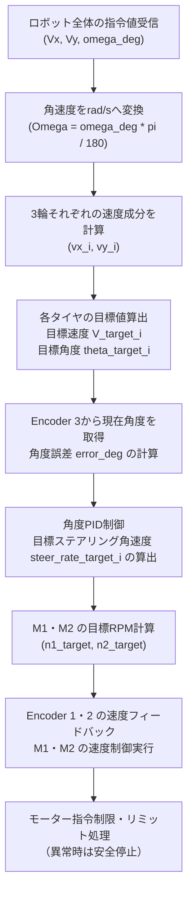

# 差動ステアリング機構の運動学・制御仕様

## 1. 目的

本書では，3輪独立ステアリングロボットに使用する差動ステアリング足回りについて，モーター2台によるタイヤ駆動・ステアリングの合成方法，エンコーダの使用方法，およびロボット全体の逆運動学を定義する。

各足回りは，モーター $M_1 \cdot M_2$ の回転を合成して，次の2つの動作を行う。

- **タイヤの駆動**
- **タイヤのステアリング旋回**

各足回りには3つのエンコーダが配置されている。

| エンコーダ | 測定対象 | 用途 |
| :--- | :--- | :--- |
| **Encoder 1** | $M_1$ の回転速度 | $M_1$ の速度フィードバック |
| **Encoder 2** | $M_2$ の回転速度 | $M_2$ の速度フィードバック |
| **Encoder 3** | タイヤのステアリング角度 | ステアリング角度フィードバック |

Encoder 1・2 はギヤを介したモーター回転を測定する。Encoder 3 はギヤを介さず，タイヤのステアリング角度を直接測定する。

---

## 2. 座標系と単位

ロボットの座標系は次のように定義する。

- 右方向を $+X$
- 前方向を $+Y$
- 右回転（時計回り）を正の角速度
- $V_x, V_y$ の単位は $\mathrm{mm/s}$
- ロボットの角速度 $\omega_{\mathrm{deg}}$ の単位は $\mathrm{deg/s}$

ロボット全体の幾何条件は次のとおりである。

| 項目 | 値 |
| :--- | :--- |
| タイヤ数 | $3$ |
| ロボット中心から各タイヤ中心までの距離 | $190.53\ \mathrm{mm}$ |
| タイヤ直径 ($D$) | $70\ \mathrm{mm}$ |
| タイヤ半径 ($R$) | $35\ \mathrm{mm}$ |

各タイヤは正三角形の頂点に配置されているものとする。

| タイヤ | 位置 $x_i\ [\mathrm{mm}]$ | 位置 $y_i\ [\mathrm{mm}]$ | 配置 |
| :--- | :--- | :--- | :--- |
| **タイヤ 1** | $0$ | $+190.53$ | 前方 |
| **タイヤ 2** | $+165.00$ | $-95.265$ | 右後方 |
| **タイヤ 3** | $-165.00$ | $-95.265$ | 左後方 |

ここで，$x_i$ は右方向を正，$y_i$ は前方向を正とする。

---

## 3. 差動ステアリング機構の実測条件

現時点で確認されている機構の関係は次のとおりである。

1. $M_1 \cdot M_2$ を逆方向にそれぞれ $1$ 回転させると，タイヤは $0.875$ 回転する。
2. $M_1 \cdot M_2$ を同方向にそれぞれ $1$ 回転させると，ステアリング角度は $180^\circ$ 変化する。

以下の式は，$M_1 \cdot M_2$ の符号がこの動作関係に合うように定義され，両モーターが同じ換算比で機構に接続されていることを仮定する。実機の配線・ギヤ配置によって符号が逆になる場合は，実験結果に合わせて符号を補正する。

---

## 4. モーター回転数から駆動・ステアリング成分への変換

$M_1 \cdot M_2$ の回転数をそれぞれ $n_1, n_2\ [\mathrm{RPM}]$ とする。

### 4.1 タイヤ駆動回転数

逆方向の回転が駆動に寄与するため，タイヤの回転数は次式とする。

$$n_{\mathrm{wheel}} = 0.4375 \times (n_1 - n_2) \quad [\mathrm{RPM}]$$

係数 $0.4375$ は，$M_1 = +1$ 回転，$M_2 = -1$ 回転のとき，タイヤが $0.875$ 回転するという実測条件から求めた（$0.875 / (1 - (-1)) = 0.875 / 2 = 0.4375$）。

### 4.2 タイヤの駆動速度

タイヤ直径を $D = 70\ \mathrm{mm}$ とすると，タイヤ周長 $C$ は次のとおりである。

$$C = \pi D = 70\pi \quad [\mathrm{mm}]$$

したがって，タイヤ接地点の速度 $V_{\mathrm{wheel}}$ は次式となる。

$$V_{\mathrm{wheel}} = n_{\mathrm{wheel}} \times \frac{\pi D}{60} = 0.4375 \times (n_1 - n_2) \times \frac{70\pi}{60} \approx 1.6030 \times (n_1 - n_2) \quad [\mathrm{mm/s}]$$

この式は，$n_1, n_2$ を $\mathrm{RPM}$ で与えた場合の式である。

### 4.3 ステアリング角速度

$M_1 \cdot M_2$ を同方向にそれぞれ $1$ 回転させたとき，ステアリングが $180^\circ$ 変化することから，ステアリング角速度 $\mathrm{steer\_rate}$ を次式とする。

$$\mathrm{steer\_rate} = 1.5 \times (n_1 + n_2) \quad [\mathrm{deg/s}]$$

ここで $\mathrm{steer\_rate}$ はステアリング角速度 $[\mathrm{deg/s}]$ である（$\frac{180^\circ}{60\ \mathrm{s} \times 2} = 1.5\ \mathrm{deg/s\ per\ RPM}$）。

### 4.4 モーター回転数の意味

- $n_1 - n_2$ が駆動成分を決める。
- $n_1 + n_2$ がステアリング成分を決める。
- **同方向・同じ回転数** では，駆動成分が $0$ となり，ステアリングが回転する。
- **逆方向・同じ絶対回転数** では，ステアリング成分が $0$ となり，タイヤが駆動する。

---

## 5. 目標タイヤ速度・目標ステアリング角速度からモーターRPMを求める

制御器から与える目標値を次のようにする。

- $V_{\mathrm{target}}$：目標タイヤ速度 $[\mathrm{mm/s}]$
- $\mathrm{steer\_rate\_target}$：目標ステアリング角速度 $[\mathrm{deg/s}]$

まず，目標タイヤ速度をタイヤ $\mathrm{RPM}$ に変換する。

$$n_{\mathrm{wheel\_target}} = \frac{60 \times V_{\mathrm{target}}}{70\pi}$$

駆動変換式より，

$$n_1 - n_2 = \frac{n_{\mathrm{wheel\_target}}}{0.4375}$$

ステアリング変換式より，

$$n_1 + n_2 = \frac{\mathrm{steer\_rate\_target}}{1.5}$$

この連立方程式を解くと，モーター目標回転数は次式になる。

$$\begin{aligned}
n_{1\_\mathrm{target}} &= 0.5 \times \left( \frac{\mathrm{steer\_rate\_target}}{1.5} + \frac{n_{\mathrm{wheel\_target}}}{0.4375} \right) \\
n_{2\_\mathrm{target}} &= 0.5 \times \left( \frac{\mathrm{steer\_rate\_target}}{1.5} - \frac{n_{\mathrm{wheel\_target}}}{0.4375} \right)
\end{aligned}$$

$n_{\mathrm{wheel\_target}}$ を展開すると，次の式でも表せる。

$$\begin{aligned}
n_{1\_\mathrm{target}} &= 0.5 \times \left( \frac{\mathrm{steer\_rate\_target}}{1.5} + \frac{60 \times V_{\mathrm{target}}}{70\pi \times 0.4375} \right) \\
n_{2\_\mathrm{target}} &= 0.5 \times \left( \frac{\mathrm{steer\_rate\_target}}{1.5} - \frac{60 \times V_{\mathrm{target}}}{70\pi \times 0.4375} \right)
\end{aligned}$$

---

## 6. ロボット全体の逆運動学

ロボット中心の入力を次のようにする。

- $V_x\ [\mathrm{mm/s}]$：右方向速度
- $V_y\ [\mathrm{mm/s}]$：前方向速度
- $\omega_{\mathrm{deg}}\ [\mathrm{deg/s}]$：右回転を正とする角速度

角速度を $\mathrm{rad/s}$ へ変換する。

$$\Omega = \omega_{\mathrm{deg}} \times \frac{\pi}{180}$$

各タイヤ位置で必要となる速度成分は次式である。

$$\begin{aligned}
v_{x\_i} &= V_x + \Omega \times y_i \\
v_{y\_i} &= V_y - \Omega \times x_i
\end{aligned}$$

ここで $v_{x\_i}$ は右方向成分，$v_{y\_i}$ は前方向成分である。

### 6.1 タイヤ1：前方

$$\begin{aligned}
v_{x\_1} &= V_x + 190.53 \times \Omega \\
v_{y\_1} &= V_y
\end{aligned}$$

### 6.2 タイヤ2：右後方

$$\begin{aligned}
v_{x\_2} &= V_x - 95.265 \times \Omega \\
v_{y\_2} &= V_y - 165.00 \times \Omega
\end{aligned}$$

### 6.3 タイヤ3：左後方

$$\begin{aligned}
v_{x\_3} &= V_x - 95.265 \times \Omega \\
v_{y\_3} &= V_y + 165.00 \times \Omega
\end{aligned}$$

### 6.4 目標駆動速度と目標ステアリング角度の算出

各タイヤの目標駆動速度は，速度ベクトルの大きさから求める。

$$V_{\mathrm{target}\_i} = \sqrt{v_{x\_i}^2 + v_{y\_i}^2}$$

ステアリング角度は，前方向（$+Y$）を $0^\circ$，右方向（$+X$）を $+90^\circ$ としたとき，次式で求める。

$$\theta_{\mathrm{target}\_i} = \mathrm{atan2}(v_{x\_i}, v_{y\_i}) \times \frac{180}{\pi}$$

> [!NOTE]
> `atan2` の引数順序は `atan2(vx_i, vy_i)` とする。これは前方向（$+Y$）を角度 $0^\circ$ とするためである。

---

## 7. ステアリング角度制御

Encoder 3 で測定した実際のステアリング角度を $\theta_{\mathrm{measured}}$，目標角度を $\theta_{\mathrm{target}}$ とする。

角度誤差は，無限回転ステアリングで不要な大回りを避けるため，通常は最短角度差として求める。

$$\mathrm{error\_deg} = \mathrm{wrap\_to\_180}(\theta_{\mathrm{target}} - \theta_{\mathrm{measured}})$$

ここで $\mathrm{wrap\_to\_180}(x)$ は角度を $[-180^\circ, +180^\circ)$ の範囲へ正規化する関数である。

角度PID制御器の出力を，目標ステアリング角速度 $\mathrm{steer\_rate\_target}\ [\mathrm{deg/s}]$ とする。

$$\mathrm{steer\_rate\_target} = \mathrm{PID}(\mathrm{error\_deg})$$

PID出力には，機構・モーターの許容範囲に基づく角速度上限を設定する。角度が $360^\circ$ をまたぐ場合も，角度誤差が不連続にならないように処理する。

### 7.1 駆動を開始するタイミング

走行中にステアリング角度を変更すると，タイヤの向きと速度ベクトルが一致しない時間が発生する。制御方針として，次のいずれかを選ぶ。

- **ステアリングを目標角度へ向けながら，駆動も同時に行う方式**
- **ステアリング誤差が一定範囲内に入るまで，タイヤ駆動速度を制限または $0$ にする方式**

どちらを採用するかは，走行安定性と応答性に応じて決める。

---

## 8. 無限回転ステアリングの注意点

タイヤのステアリング角度は無限回転可能であるが，$\mathrm{atan2}$ が返す角度は通常 $-180^\circ \sim +180^\circ$ である。目標角度を連続的に扱う場合は，現在角度に近い等価角度を選ぶか，角度をアンラップして扱う。

また，独立ステアリングでは次の2つの指令が同じタイヤ速度ベクトルを表す。

$$\begin{aligned}
&(V_{\mathrm{target}}, \theta_{\mathrm{target}}) \\
&(-V_{\mathrm{target}}, \theta_{\mathrm{target}} + 180^\circ)
\end{aligned}$$

そのため，ステアリング移動量を小さくする目的で，角度を $180^\circ$ 反転し，駆動速度の符号を反転する方式も使用できる。ただし，負の駆動速度を許容すること，および実機の符号定義が一致していることが条件である。

タイヤ速度がほぼ $0$ のときは，速度ベクトルからステアリング角度を決定できない。その場合は，ステアリング目標角度を前回値に保持するなどの処理を行う。

---

## 9. 制御処理の全体フロー

1. ロボット全体の $V_x, V_y, \omega_{\mathrm{deg}}$ を受け取る。
2. 角速度を $\mathrm{rad/s}$ へ変換する。
3. 3輪それぞれの $v_{x\_i}, v_{y\_i}$ を計算する。
4. 各タイヤの目標速度 $V_{\mathrm{target}\_i}$ と目標角度 $\theta_{\mathrm{target}\_i}$ を計算する。
5. Encoder 3 の角度を読み，角度誤差を計算する。
6. 角度PIDから目標ステアリング角速度 $\mathrm{steer\_rate\_target}\_i$ を計算する。
7. 目標タイヤ速度と目標ステアリング角速度から，$M_1 \cdot M_2$ の目標 $\mathrm{RPM}$ を計算する。
8. Encoder 1・2 の速度フィードバックを用いて，$M_1 \cdot M_2$ の速度制御を行う。
9. モーター指令を制限し，異常時は安全に停止する。

---

## 10. 実機での符号・換算係数の確認

現段階では，モーターの正方向，エンコーダの符号，およびステアリングの正方向は確定していない。制御実装前に，低速・無負荷または安全に固定した状態で次の試験を行う。

1. $M_1$ だけを正方向に低速回転させ，$M_1$ のエンコーダ符号，タイヤ駆動方向，ステアリング方向を記録する。
2. $M_2$ だけについて同じ試験を行う。
3. $M_1 \cdot M_2$ を同方向に同じ回転数で動かし，ステアリング方向と角度変化量を確認する。
4. $M_1 \cdot M_2$ を逆方向に同じ回転数で動かし，タイヤ回転数と方向を確認する。
5. Encoder 3 の正方向が，定義したステアリング正方向と一致するか確認する。
6. 目標 $\mathrm{RPM}$ と実測 $\mathrm{RPM}$ の符号・倍率を比較し，換算係数を検証する。

配線やギヤの構成により，$n_1 - n_2$ と $n_1 + n_2$ の符号が逆になる可能性がある。実験結果に応じて，モーター符号または変換式を修正する。

---

## 11. 前提・制約

- **駆動換算係数 $0.4375$**：逆方向に各モーターを $1$ 回転させるとタイヤが $0.875$ 回転するという実測値に基づく。
- **ステアリング換算係数 $1.5\ \mathrm{deg/s\ per\ RPM\text{-}sum}$**：同方向に各モーターを $1$ 回転させるとステアリングが $180^\circ$ 変化するという実測値に基づく。
- これらの式は，機構が線形であり，両モーターの換算比が対称であることを仮定する。
- バックラッシュ，弾性変形，摩擦，モーター速度制御誤差などは別途考慮する。
- ステアリングPIDのゲイン，速度上限，加速度制限，停止条件は実機試験で調整する。
- 駆動換算係数とステアリング換算係数は，実機で複数の回転数を用いて検証する。
